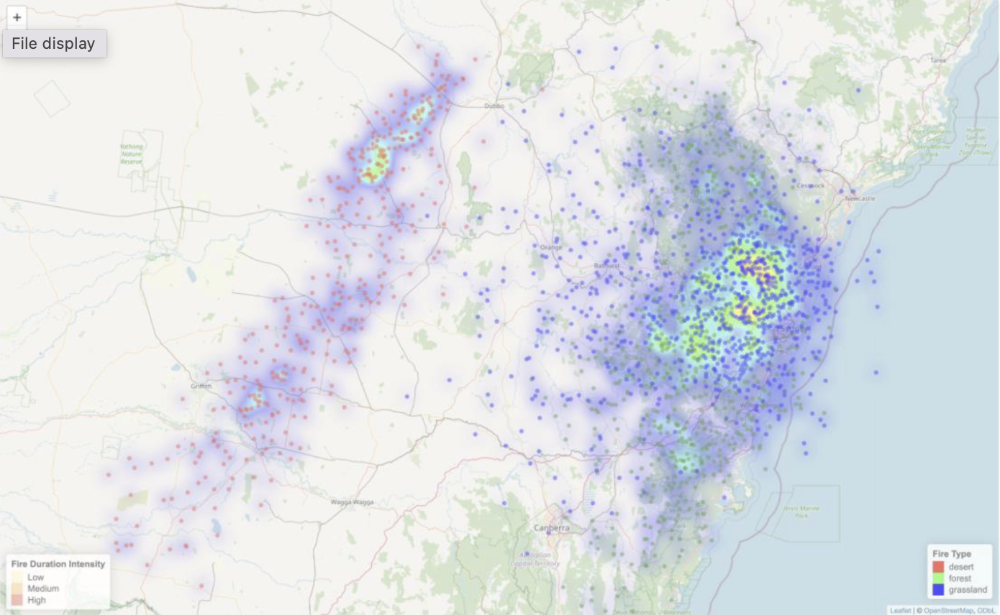
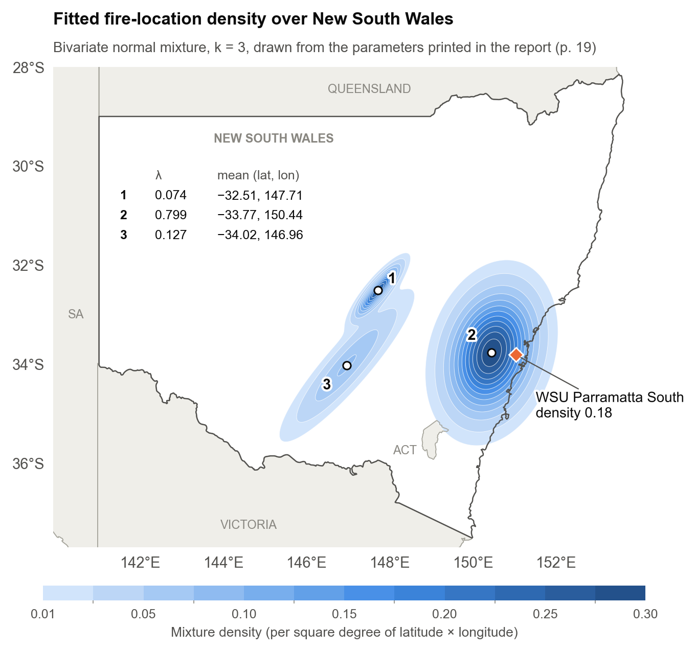
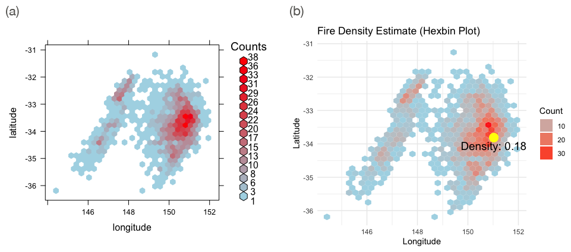
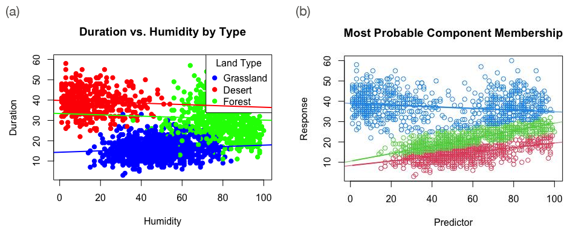
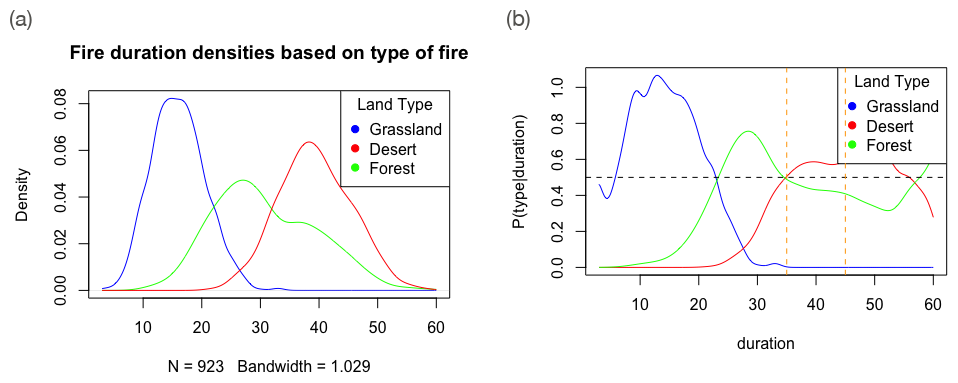
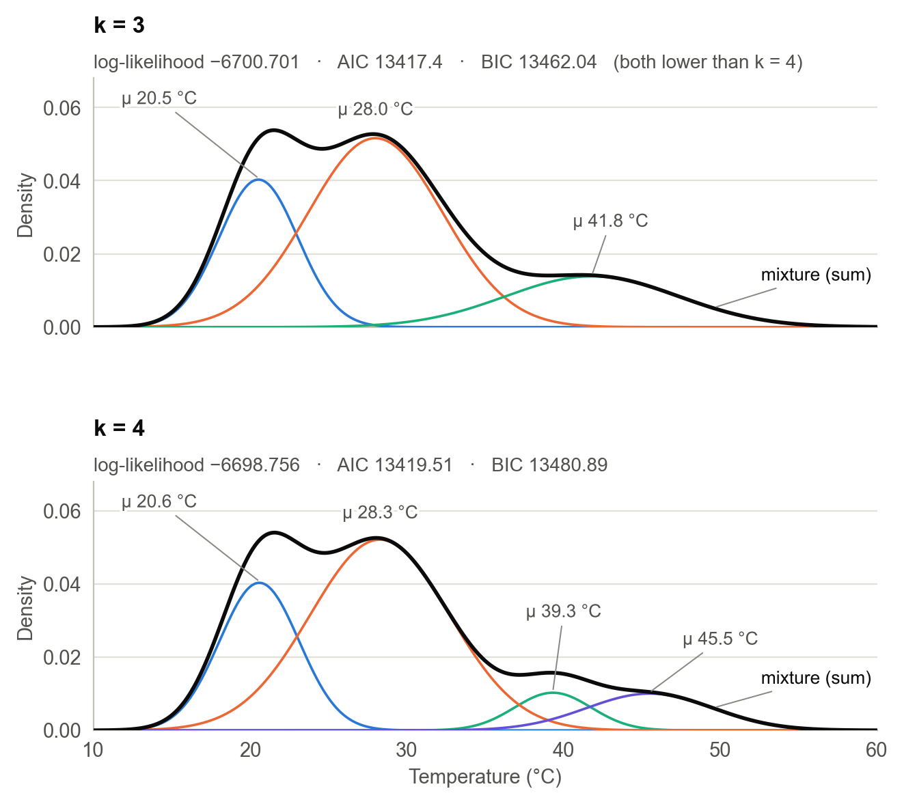
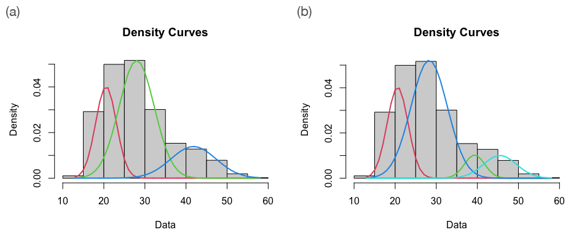
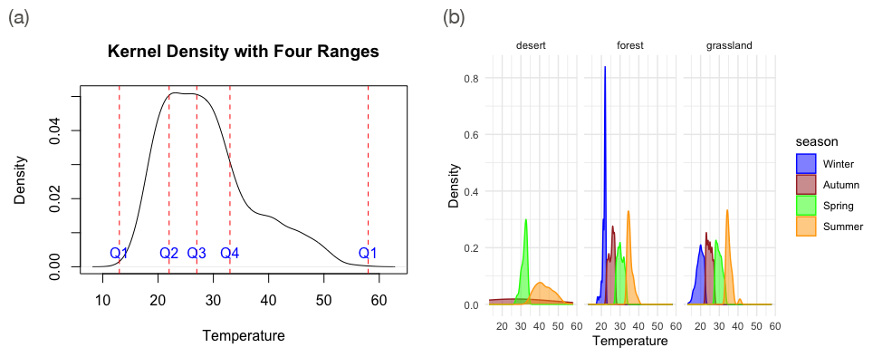
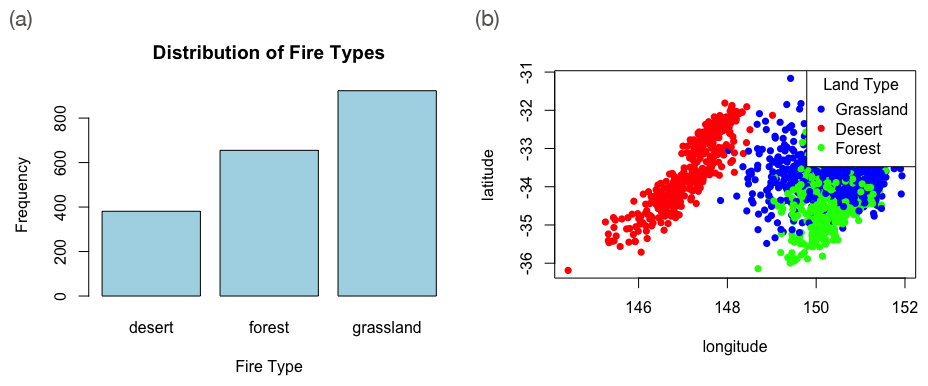
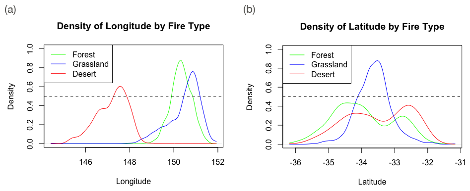

<h1 align="center">Mixture models for NSW fire data</h1>

<p align="center">
  <b>Where fires cluster across New South Wales, what shapes their duration, which retardants to stock, and whether temperature reveals the seasons.</b><br>
  Bivariate normal mixtures, mixtures of regressions, kernel density ratios and temperature mixtures in R (<code>mixtools</code>, <code>MASS</code>), applied to 1,959 fire records.
</p>

<p align="center">
  
  
  
  <a href="Fire2024-Report.pdf"></a>
  <a href="ASM-Fire2024.Rmd"></a>
  
</p>

<p align="center"></p>
<p align="center"><sub><i>Fire locations by type, with a heatmap weighted by the square root of duration. Screenshot of the Leaflet map built in ASM-Fire2024.Rmd (p. 15 of the report); map data © OpenStreetMap contributors.</i></sub></p>

<p align="center">
  <a href="#at-a-glance">At a glance</a> ·
  <a href="#results">Results</a> ·
  <a href="#method">Method</a> ·
  <a href="#data">Data</a> ·
  <a href="#reproduce">Reproduce</a> ·
  <a href="#notes-and-limitations">Notes</a>
</p>

---

## At a glance

| Task | Question | Method | Headline result |
|---|---|---|---|
| 1. Location | Where do fires concentrate, and what is the fire density at WSU Parramatta South? | Bivariate normal mixture (`mvnormalmixEM`, k = 3); 2-D kernel density (`kde2d`) | Density 0.18 from the mixture, 0.27 from the kernel estimate |
| 2. Humidity and duration | Does something besides humidity drive fire duration? | Mixture of linear regressions (`regmixEM`, k = 2, 3, 4) | k = 3 has the lowest BIC (14420.23); its components point mainly to fire type |
| 3. Equipment | Which retardant mix suits fires lasting 35–45 minutes? | P(type \| duration) from kernel densities, integrated over 35–45 min | Per 100 retardants: 56 desert, 43 forest, 1 grassland |
| 4. Seasons | Can temperature alone identify four seasons? | Normal mixtures (`normalmixEM`, k = 3 and 4) | AIC and BIC both favour k = 3; four seasons are not identified |
| Preliminary | Are the three fire types equally common? | Chi-squared goodness-of-fit test | No: χ² = 224.94, df = 2, p < 2.2e-16 |

## Results

Page references (p. N) are to [`Fire2024-Report.pdf`](Fire2024-Report.pdf), counting the cover sheet as p. 1.

### Task 1: where fires concentrate

<p align="center"></p>
<p align="center"><sub><i>Fitted three-component mixture density, re-drawn from the λ, μ and Σ printed on p. 19 of the report. State boundaries from Natural Earth (public domain).</i></sub></p>

One broad component, centred west of Sydney where forest and grassland fires overlap, carries most of the weight (λ = 0.80). Two smaller ones (λ = 0.07 and 0.13) sit on the western band of desert fires. Component 3 is long and tilted because latitude and longitude move together within it (covariance 0.551 against variances of 0.580 and 0.639).

At WSU Parramatta South, in a region with over 30 reported fire incidents, the mixture gives a density of 0.18 per square degree, a medium likelihood of fire (p. 22). A two-dimensional kernel density estimate at the same point gives 0.27 (p. 23): it follows local clusters, while the mixture smooths over them. Location shapes fire density and should guide where fire rescue stations go (p. 22–23).

<p align="center"></p>
<p align="center"><sub><i>(a) Fire counts per hexagon (p. 17) and (b) a hexbin plot with the mixture density marked at WSU Parramatta South (p. 22). Extracted from the report.</i></sub></p>

### Task 2: humidity and fire duration

<p align="center"></p>
<p align="center"><sub><i>(a) Duration against humidity with one fitted line per fire type (p. 25) and (b) each fire's most probable component under the three-component mixture of regressions (p. 29). Extracted from the report.</i></sub></p>

| k | Log-likelihood | AIC | BIC |
|---|---|---|---|
| 2 | −7187.401 | 14388.8 | 14427.86 |
| 3 | −7168.426 | 14358.85 | **14420.23** |
| 4 | −7164.355 | 14358.71 | 14442.41 |

BIC, which charges more for extra parameters, is lowest at k = 3, so three components were kept, although k = 4 has the highest log-likelihood and a marginally lower AIC (p. 29).

| Component (colour in b) | λ | Intercept (min) | Slope (min per % humidity) | Residual σ (min) |
|---|---|---|---|---|
| 1 (red) | 0.313 | 8.37 | 0.111 | 3.42 |
| 2 (green) | 0.285 | 10.54 | 0.187 | 3.44 |
| 3 (blue) | 0.403 | 38.98 | −0.0416 | 7.34 |

Component 3 holds the long fires, whose duration falls slightly as humidity rises; components 1 and 2 hold shorter fires whose duration rises with humidity. The long cluster mixes desert and forest fires and the short ones mix grassland and forest fires, so the hidden factor is mainly fire type, with vegetation, terrain and wind speed as further factors the data cannot cover (p. 30).

### Task 3: retardant mix for 35–45 minute fires

<p align="center"></p>
<p align="center"><sub><i>(a) Kernel densities of duration by fire type (p. 32) and (b) P(type | duration) with the 35 and 45 minute bounds dashed in orange (p. 33). Extracted from the report.</i></sub></p>

| Retardant | Share for 35–45 min fires |
|---|---|
| Desert | 56.5% |
| Forest | 43.5% |
| Grassland | 0.01% |

Grassland fires are the most common type but short, peaking around 10–15 minutes, so they almost vanish from the 35–45 minute window, which desert fires (peak around 30–40 minutes) and forest fires (peak between the two) share. An order of 100 retardants would hold 56 desert, 43 forest and 1 grassland, keeping one grassland unit because an order of zero would not make sense (p. 34).

### Task 4: temperature and seasons

<p align="center"></p>
<p align="center"><sub><i>Weighted components λ·N(μ, σ²) (thin) and their sum (thick), re-drawn from the normalmixEM estimates on p. 38 of the report; log-likelihoods, AIC and BIC from p. 36–39.</i></sub></p>

With k = 4, EM splits the warm component of the three-component fit (mean 41.8 °C) into two small components at 39.3 °C and 45.5 °C, while the cool and mild components barely move. The log-likelihood rises from −6700.701 to −6698.756; a likelihood-ratio test gives p = 0.049, and AIC (13417.4 against 13419.51) and BIC (13462.04 against 13480.89) both favour k = 3. The four seasons cannot be completely identified from temperature data, possibly because autumn and spring temperatures fall in a similar range (p. 39).

<details>
<summary>Original mixtools plots, with the temperature histogram</summary>
<br>
<p align="center"></p>
<p align="center"><sub><i>(a) k = 3 (p. 37) and (b) k = 4 (p. 38). Extracted from the report.</i></sub></p>
</details>

As a descriptive alternative, temperature was cut at its quartiles into four bands of 495, 500, 508 and 456 fires, labelled Winter, Autumn, Spring and Summer from coolest to warmest, and their densities were compared by fire type (p. 35, p. 39–40).

<p align="center"></p>
<p align="center"><sub><i>(a) Kernel density of temperature with dashed lines at the minimum, quartiles and maximum (p. 36) and (b) densities by quartile-based season and fire type (p. 40). Extracted from the report.</i></sub></p>

### Preliminary analysis: fire types

<p align="center"></p>
<p align="center"><sub><i>(a) Fires by type (p. 6) and (b) fire locations by type (p. 16). Extracted from the report.</i></sub></p>

Against equal shares (653 expected per type), a chi-squared goodness-of-fit test on the 381 desert, 655 forest and 923 grassland fires gives χ² = 224.94 with 2 degrees of freedom and p < 2.2e-16, so equal proportions are rejected (p. 7).

<details>
<summary>Exploratory plots: longitude and latitude by fire type</summary>
<br>
<p align="center"></p>
<p align="center"><sub><i>Kernel densities of (a) longitude (p. 12) and (b) latitude (p. 14) by fire type. Extracted from the report.</i></sub></p>
</details>

## Method

### Task 1: bivariate normal mixture and kernel density

Fire locations z = (latitude, longitude) were modelled as a mixture of three bivariate normal distributions, fitted by expectation-maximisation with `mvnormalmixEM(coords, k = 3)` on all 1,959 fires (`set.seed(13)`). The density at a location is the weighted sum of the three bivariate normal densities (p. 20–21):

$$
f(z) = \sum_{i=1}^{3} \lambda_i \mathcal{N}(z; \mu_i, \Sigma_i)
$$

| Component | λ | Mean (lat, lon) | Variances (lat, lon) | Covariance |
|---|---|---|---|---|
| 1 | 0.074 | −32.51, 147.71 | 0.0890, 0.0936 | 0.0785 |
| 2 | 0.799 | −33.77, 150.44 | 0.518, 0.375 | 0.100 |
| 3 | 0.127 | −34.02, 146.96 | 0.580, 0.639 | 0.551 |

The number of components came from `boot.comp` (bootstrap likelihood-ratio tests for up to four components on a random sample of 300 locations), which gave p-values of 0.00, 0.02 and 0.09 for one, two and three components, so three were enough (p. 18). For comparison, `MASS::kde2d` estimated a two-dimensional kernel density with normal-reference bandwidths (`bandwidth.nrd`) on a 100 × 100 grid; its value at WSU is the average of linear interpolations along the nearest grid row and column (p. 23).

### Task 2: mixture of linear regressions

`regmixEM(duration, humidity, k, arbvar = TRUE)` fitted mixtures of k = 2, 3 and 4 regressions of duration on humidity, each component with its own intercept, slope and residual standard deviation (`set.seed(4)`). The case for separate variances came from the within-type standard deviations of duration: 6.17 minutes for desert, 8.70 for forest and 4.52 for grassland fires (p. 25). The models were compared with AIC = −2 log L + 2p and BIC = −2 log L + p log n, using p = 7, 11 and 15 parameters and n = 1,959 (p. 28).

### Task 3: conditional probability of fire type given duration

Duration densities were estimated with Gaussian kernels (R `density()`, default bandwidth) for all fires, f(d), and for each type, f<sub>type</sub>(d). With p<sub>type</sub> the share of each type in the data, Bayes' rule gives the curves in panel (b) above, and each retardant's share is the normalised integral of its curve over 35–45 minutes (`integrate` over a linear interpolation):

$$
P(\text{type} \mid d) = \frac{p_{\text{type}} \ f_{\text{type}}(d)}{f(d)}, \qquad
\text{share}(\text{type}) = \frac{\int_{35}^{45} P(\text{type} \mid d) \ \mathrm{d}d}{\sum_{t} \int_{35}^{45} P(t \mid d) \ \mathrm{d}d}
$$

### Task 4: normal mixtures of temperature

The fits `normalmixEM(temp, k = 3)` and `normalmixEM(temp, k = 4, maxit = 1e5)` were compared by AIC and BIC with 3k − 1 free parameters, and by the likelihood-ratio statistic 2(log L<sub>4</sub> − log L<sub>3</sub>) on a χ² distribution with 1 degree of freedom (p. 39). A `boot.comp` check with up to four components, one per season, suggested k = 3 (p. 35).

## Data

`fire2024.csv` was supplied for the assignment and is not in this repository; its origin and licence are not recorded. It has 1,959 rows, six variables and no dates (p. 4, p. 35). Units are from the pop-up labels in the map code.

| Variable | Unit or levels | Range (mean) |
|---|---|---|
| `latitude` | decimal degrees | −36.19 to −31.17 (−33.71) |
| `longitude` | decimal degrees | 144.4 to 151.9 (149.8) |
| `type` | desert, forest, grassland | 381, 655 and 923 fires |
| `duration` | minutes | 3 to 60 (25.49) |
| `temp` | °C | 13 to 58 (28.76) |
| `humidity` | % | 1 to 100 (52.43) |

The only preprocessing was converting `type` to a factor. The base map in `FireNSW24.png` uses OpenStreetMap tiles: map data © [OpenStreetMap contributors](https://www.openstreetmap.org/copyright), available under the Open Database License (ODbL). State boundaries in the re-drawn map are [Natural Earth](https://www.naturalearthdata.com/) admin-1 data (public domain).

## Repository contents

| File | Description |
|---|---|
| [`ASM-Fire2024.Rmd`](ASM-Fire2024.Rmd) | R Markdown source: data import, exploratory plots, chi-squared test, Tasks 1–4 and the Leaflet map |
| [`Fire2024-Report.pdf`](Fire2024-Report.pdf) | The report, 41 pages: assignment cover sheet (p. 1), contents (p. 2) and the knitted analysis (p. 3–41) |
| [`FireNSW24.png`](FireNSW24.png) | Screenshot of the Leaflet map of fire locations, the same map as p. 15 of the report; the R Markdown includes it on line 255 |
| [`docs/images/`](docs/images) | Figures for this README, extracted from the report or re-drawn from its printed parameters |

Not included: `fire2024.csv`.

## Reproduce

The R version is not recorded. Start-up warnings in the report say several packages were built under R 4.3.1 and 4.3.3, which R prints when running an older version (p. 3–4). Only `mixtools` has its version printed (2.0.0).

```r
install.packages(c("hexbin", "mixtools", "mvtnorm", "ggplot2", "dplyr",
                   "leaflet", "leaflet.extras", "htmltools", "rmarkdown"))
# MASS ships with R; knitr is installed with rmarkdown
```

1. Put `fire2024.csv` next to `ASM-Fire2024.Rmd`.
2. Knit with `rmarkdown::render("ASM-Fire2024.Rmd")`. The first output in the YAML header is `word_document`, so this produces a Word file; the PDF in this repository adds a cover sheet and a contents page.

The `boot.comp` chunks are commented out because they crashed during the original knit; uncomment them to run the component tests. The Leaflet map is built but not printed (`map` is commented out on line 251).

## Context

Individual assignment for *Advanced Statistical Methods*, Western Sydney University. The report was knitted on 2024-10-28.

## Notes and limitations

- `fire2024.csv` is not included, so nothing here can be re-run. The two re-drawn figures use only parameters printed in the report; evaluated at the campus, the Task 1 mixture reproduces the printed 0.18.
- The mixture and kernel densities are per square degree of latitude and longitude: they rank locations but are not probabilities.
- Both `boot.comp` runs (Tasks 1 and 4) were commented out, so the component counts they suggest rest on values quoted in the report.
- The data has no dates, so the Task 4 "seasons" are temperature bands.
